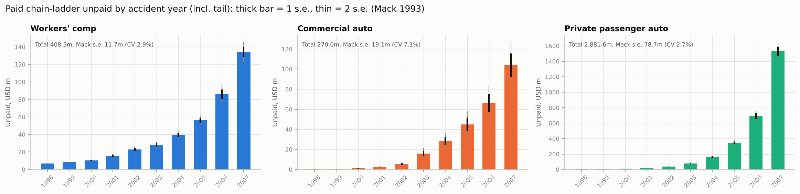
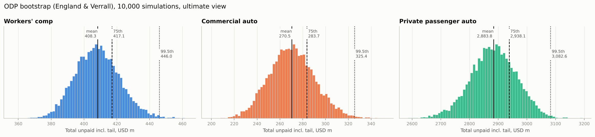
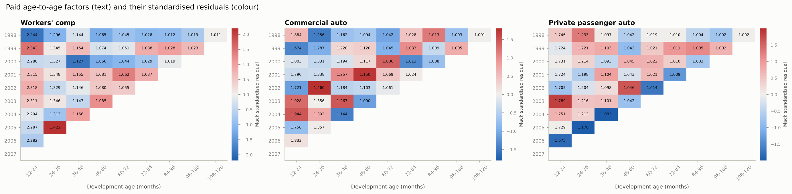
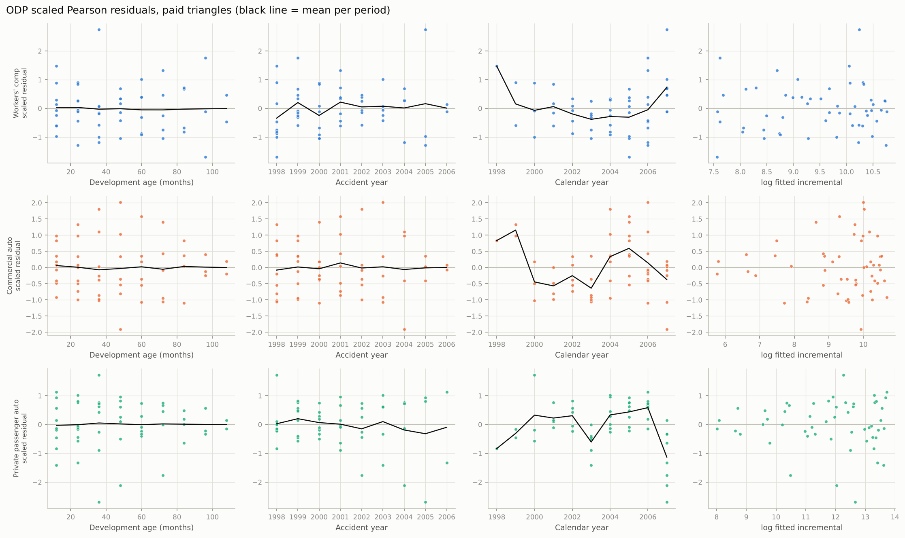
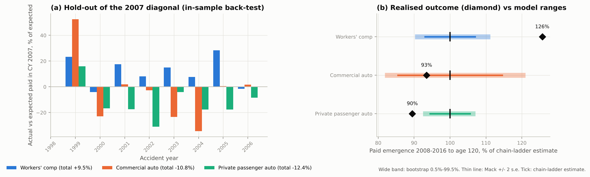

# Claims reserving with chain ladder, Mack and the ODP bootstrap (CAS Schedule P data)

I estimate P&C loss reserves for three US lines of business on public NAIC Schedule P data. Every method is written from scratch in numpy and checked against the `chainladder` package and against published values. Then I compare the projections with what was actually paid in the nine years after the valuation date.

## Business problem

At every balance-sheet date a non-life insurer must hold a reserve for claims that have occurred but are not yet paid. A reserving actuary has three jobs here. The first is to estimate the best-estimate reserve with more than one method. The second is to say how uncertain that estimate is, which is the input to a risk margin and to the reserve-risk part of Solvency II / SST capital. The third is to check whether the method's assumptions hold, and whether last year's projections came true (actual vs expected).

This project does all three for three company/line combinations, with a valuation date of 31.12.2007. The data also contains the development of those accident years up to 2016, which the models never see. That makes an honest out-of-sample check possible, which a real reserving team only gets years later.

## Data

**Source:** CAS Loss Reserve Database, built from NAIC Schedule P (Parts 1-4) by the Casualty Actuarial Society. The original 1988-1997 edition is described in Meyers & Shi (2011), *Loss Reserving Data Pulled From NAIC Schedule P*, CAS. This project uses the accident-year 1998-2007 edition shipped as `clrd2025.csv` with the `chainladder` Python package (0.10.1, MPL-2.0 license). I picked that edition because it contains **full 10x10 squares**: the lower triangle (calendar years 2008-2016) is the actual later development. The package itself does not document where this file came from, and casact.org is not reachable from the environment where I built the project, so I could not check the file against the CAS original.

- Amounts are in USD thousands and net of reinsurance. The tables below show USD m.
- `CumPaidLoss` is cumulative paid loss + DCC. **Case incurred** = `IncurredLosses - BulkLoss`. Schedule P incurred already contains the company's own bulk/IBNR reserve, which has to be removed before an incurred chain ladder can estimate IBNR on its own terms.
- `EarnedPremNet` is the exposure base for Bornhuetter-Ferguson and Cape Cod.

| Segment | Company (NAIC group) | Line | Net earned premium AY 1998-2007 | Paid to date (2007) | Case reserves (2007) |
|---|---|---|---:|---:|---:|
| wkcomp | State Farm Mut Grp | Workers' compensation | 3,063.5 | 1,049.9 | 244.1 |
| comauto | Erie Ins Exchange Grp | Commercial auto liability | 1,801.2 | 957.3 | 96.4 |
| ppauto | USAA Grp | Private passenger auto liability | 27,141.0 | 16,768.6 | 1,451.3 |

How I chose them: the largest groups in each line that have a complete 10x10 square, strictly positive premium, and almost no negative paid increments. I fixed this choice before looking at any results. `data/download_data.py` extracts the 300 rows used (`data/processed/segments_long.csv`). The 5.9 MB raw file is not committed because the package already bundles it, and the script downloads it from the chainladder GitHub repository if the bundled copy is missing.

Known data issue: State Farm workers' comp has net earned premium of 451.5m for AY 2001, against 191-235m in the years around it. The loss ratio for that year (31-34%) is therefore out of line. This affects BF and Cape Cod for AY 2001 only. I left the data unchanged and flag it here.

## Approach

| Step | Method | Why |
|---|---|---|
| Development factors | Volume-weighted chain ladder, `f_j = sum C_{i,j+1} / sum C_ij` | This is the estimator Mack (1993) proves unbiased under his model. It is the market-standard starting point. |
| Tail | Exponential decay fit of `ln(f_j - 1)` on age, from 36 months onwards, extrapolated 100 years. **Paid tail** = max(curve, incurred-to-paid ratio of the oldest AY at 120m x incurred tail). | The exponential curve fades out quickly. For workers' comp it gives a paid tail of only 1.022, but the oldest accident year still has 5.4% case reserves on top of paid at 120 months. Paid has to reach at least the incurred level. |
| Uncertainty, analytic | Mack (1993) process and parameter error, plus the covariance term for the total. The last sigma uses Mack's extrapolation rule. | Distribution-free and transparent. With a constant tail I scale the s.e. by the tail factor, so tail parameter uncertainty is **not** included. |
| Exposure-based | Bornhuetter-Ferguson with a priori ELR = premium-weighted incurred chain-ladder loss ratio of the 5 most mature AYs (1998-2002). Cape Cod: ELR = reported losses / used-up premium. | Chain-ladder ultimates for the latest AYs depend heavily on a small paid or reported amount. BF stabilises them with a prior. Cape Cod takes the prior from the data instead of from judgement. |
| Selection | Incurred chain ladder for AY <= 2004 (at least 48 months developed). Incurred BF for AY 2005-2007. | A common rule of thumb. I fixed it before looking at the outcome data. |
| Distribution | ODP bootstrap (England & Verrall 2002): Pearson residuals, bias adjustment `sqrt(n/(n-p))`, zero corner residuals removed, Gamma process error. 10,000 simulations, seed 2026. | Gives a full predictive distribution (percentiles, expected shortfall), which Mack does not. |
| Diagnostics | Mack standardised residuals. ODP residuals against development, accident and calendar year and fitted value. Mack (1994) calendar-year test and adjacent-factor correlation test. | These test the chain-ladder assumptions: no diagonal effects, and uncorrelated successive factors. |
| Back-tests | (a) Remove the 2007 diagonal, refit, compare actual and expected 2007 payments. (b) Compare the projections to age 120 with the real 2008-2016 emergence. | (a) is what a reserving team does every year (AvE). (b) tests the methods out of sample. |

### Validation of the from-scratch code

`src/` uses only numpy, pandas and scipy. `tests/` (117 pytest tests) checks the results against `chainladder` 0.10.1 on RAA, Taylor-Ashe (GenIns) and all six CAS triangles used here:

| Quantity | Max relative difference vs chainladder (6 CAS triangles) |
|---|---:|
| Volume-weighted LDFs, CL ultimates, BF and Cape Cod ultimates | 0 |
| Exponential tail factor | 9e-16 |
| Mack s.e. by accident year / total | 1.2e-12 / 3e-15 |

- **Published Mack values are reproduced to the unit.** Taylor-Ashe gives a reserve of 18,680,856 and a total s.e. of 2,447,095 (Mack 1993). RAA gives 52,135 and 26,909.
- **Mack (1994) tests.** The calendar-year statistic Z, E[Z] and Var[Z], and the development-correlation statistic T, are identical to `chainladder`'s `valuation_correlation` and `development_correlation`. I compute the accept/reject decision myself because, in 0.10.1, the `total=True` flag compares Var(Z) with an interval built around Var(Z) instead of comparing Z with E[Z] +/- z * sd.
- **Bootstrap.** It is stochastic, so it cannot match exactly. With the package's settings (no bias adjustment, centred residuals), the mean agrees within 1%, and the standard deviation and 99.5th percentile within 4%. That holds both without and with process error.
- **R cross-check.** `r/chainladder.R` re-implements the chain ladder and Mack in base R. Its testthat test reproduces the Python LDFs, ultimates and Mack s.e. for workers' comp paid.

## Results

All numbers come from `python -m src.pipeline`. The CSV tables are in `reports/tables/`. Unpaid = estimated ultimate - paid to date (case reserves + IBNR), including the tail.

### Tail selection

| Segment | Paid curve | Incurred curve | Incurred/paid, AY1998 @120m | **Paid tail** | **Incurred tail** |
|---|---:|---:|---:|---:|---:|
| Workers' comp | 1.0216 | 1.0156 | 1.0537 | **1.0701** | **1.0156** |
| Commercial auto | 1.0013 | 1.0010 | 1.0051 | **1.0061** | **1.0010** |
| Private passenger auto | 1.0011 | 1.0006 | 1.0017 | **1.0023** | **1.0006** |

### Total unpaid by method at 31.12.2007 (USD m)

| Segment | Paid CL | Incurred CL | Paid BF | Incurred BF | Paid CC | Incurred CC | **Selected** | A priori ELR | Cape Cod ELR (inc.) |
|---|---:|---:|---:|---:|---:|---:|---:|---:|---:|
| Workers' comp | 408.5 | 533.6 | 463.9 | 538.6 | 428.7 | 536.0 | **538.8** | 52.2% | 51.8% |
| Commercial auto | 270.0 | 266.2 | 350.9 | 323.1 | 316.9 | 298.0 | **319.5** | 78.3% | 69.7% |
| Private passenger auto | 2,881.6 | 2,802.3 | 2,871.6 | 2,833.4 | 2,769.2 | 2,785.2 | **2,821.9** | 74.6% | 72.0% |

### Reserve uncertainty: Mack vs ODP bootstrap (paid chain ladder, USD m)

| Segment | CL unpaid | Mack s.e. (CV) | Bootstrap mean | Bootstrap s.d. (CV) | 75th pct | 99.5th pct | ES 99% | 99.5th / mean |
|---|---:|---:|---:|---:|---:|---:|---:|---:|
| Workers' comp | 408.5 | 11.7 (2.9%) | 408.3 | 13.5 (3.3%) | 417.1 | 446.0 | 447.7 | 1.092 |
| Commercial auto | 270.0 | 19.1 (7.1%) | 270.5 | 20.1 (7.4%) | 283.7 | 325.4 | 328.1 | 1.203 |
| Private passenger auto | 2,881.6 | 78.7 (2.7%) | 2,883.8 | 79.9 (2.8%) | 2,938.1 | 3,082.6 | 3,091.4 | 1.069 |

The two methods are built on different models (Mack's distribution-free recursion and an over-dispersed Poisson GLM), yet their standard deviations differ by only 1.5-15%. That agreement is a useful cross-check.

**About the 99.5th percentile.** Solvency II calibrates the SCR to the 99.5% VaR of a **one-year** change in own funds. The SST uses the 99% expected shortfall, also over one year. The distribution above is an **ultimate view**: it covers all uncertainty until the claims are fully run off. It is therefore wider than the one-year claims development result that the regulation needs, and the 99.5th percentile - mean (37.7m for workers' comp) is **not** a reserve-risk SCR. The one-year view needs the Merz-Wüthrich (2008) formula or a re-reserving ("actuary-in-the-box") bootstrap, which is listed under next steps. The figures also include no risk margin, no discounting and no allowance for model error.





### Diagnostics of the chain-ladder assumptions

| Segment | Basis | Calendar-year test Z (95% band) | Reject? | Adjacent-factor correlation T (50% band +/-0.127) | Reject? |
|---|---|---|---|---:|---|
| Workers' comp | paid | 14 (8.9-16.1) | no | +0.470 | **yes** |
| Workers' comp | incurred | 10 (8.9-16.1) | no | +0.087 | no |
| Commercial auto | paid | 10 (9.0-16.5) | no | +0.008 | no |
| Commercial auto | incurred | 9 (8.9-16.1) | no | +0.363 | **yes** |
| Private passenger auto | paid | 9 (8.9-16.1) | no | +0.033 | no |
| Private passenger auto | incurred | 6 (8.9-16.1) | **yes** | -0.294 | **yes** |

- **Workers' comp, paid.** T = 0.47 is about 4.8 standard deviations from zero, so the result does not depend on the loose 50% band Mack recommends. The heat map shows why: AY 2001-2005 develop *above* the average factor at most ages, while 1998 and 2000 develop below it. The payment pattern is getting slower and longer, so averaging over all years understates the remaining development.
- **Private passenger auto, incurred.** The calendar-year test rejects. Low factors cluster on the latest diagonals, which points to a change in case reserving or settlement speed. The latest paid diagonal is also low (blue in the heat map, falling calendar-year residuals in 2007).





### Back-tests

**(a) Holding out the 2007 diagonal.** Paid in calendar year 2007, actual vs expected from a model fitted to data up to 2006:

| Segment | Paid AvE | Incurred AvE |
|---|---:|---:|
| Workers' comp | **+9.5%** | -6.8% |
| Commercial auto | -10.8% | -18.4% |
| Private passenger auto | -12.4% | -15.9% |

**(b) Real run-off, 2008-2016.** Emergence to age 120 months, without tail, compared with the 2007 projections:

| Segment | Paid CL projected | Actual | Actual / CL | Mack z | Bootstrap percentile of actual | Paid BF | Paid CC |
|---|---:|---:|---:|---:|---:|---:|---:|
| Workers' comp | 313.0 | 393.4 | **+25.7%** | +7.3 | 100.0 (above all 10,000 sims) | +4.0% | +18.5% |
| Commercial auto | 262.5 | 245.4 | -6.5% | -0.9 | 19.0 | -28.7% | -20.6% |
| Private passenger auto | 2,836.7 | 2,538.9 | **-10.5%** | -3.8 | 0.0 (below all sims) | -10.3% | -6.8% |

On the incurred basis (emergence of case incurred), the incurred chain ladder was off by +25.1% (workers' comp), -8.0% (commercial auto) and -17.0% (private passenger auto). The selected incurred estimate was off by +22.8%, -30.1% and -18.2%.



### Paid vs incurred: commentary

- **Workers' comp: paid and incurred disagree a lot** (408.5m vs 533.6m unpaid). Paid-to-incurred ratios at early ages are falling: AY 2006 was 35% paid at 12 months against 41-47% for 1998-2004, and AY 2005/2006 were 65%/61% at 24 months against 70-75% before (see `reports/figures/paid_to_incurred.png`). When this happens, the usual question is whether payments have slowed down or case reserves have been strengthened. The heat map, the correlation test and the +9.5% paid AvE on the 2007 diagonal all point to *slower payments*, which means the paid chain ladder is too low. That is why the selection relies on incurred. In hindsight even incurred was 25% short, so there was also genuine adverse development that no method on this triangle could see. Of all methods, the paid BF came closest (+4%), because its prior did not depend on the slowing paid pattern.
- **Commercial auto: paid and incurred chain ladder agree** (270.0m vs 266.2m), and paid-to-incurred ratios are broadly stable (59-63% at 12 months, apart from 2003 and 2006). BF and Cape Cod are much higher because the prior (78% ELR from AY 1998-2002) is far above the 55-61% chain-ladder loss ratios of AY 2005-2007. The most likely reason is the post-2001 hard market (rate increases lower the loss ratio), but the data has no rate information to confirm this. A BF prior without rate-change adjustment is exactly the mistake a pricing-reserving hand-off should prevent. Out of sample, this cost 29-31%. My selection (BF for the last three AYs) was therefore worse than the plain chain ladder here.
- **Private passenger auto: paid and incurred agree within 3%.** Paid-to-incurred at 12 months rises steadily, from 55% (AY 1998) to 62% (AY 2007): claims are being paid faster, so applying historical paid factors over-projects. Both the diagonal back-test (-12%/-16%) and the calendar-year test warned that recent diagonals were developing faster or lower than history. The realised run-off was 10% below the paid projection.

## Key takeaways, limitations, next steps

- **The diagnostics predicted the direction of the error every time.** In all three segments, the sign of the paid AvE on the held-out diagonal matched the sign of the real 2008-2016 deviation (+9.5% → +25.7%; -10.8% → -6.5%; -12.4% → -10.5%). This is the practical argument for doing AvE every quarter.
- **Mack and bootstrap measure the uncertainty of a model, not model error.** For workers' comp and private passenger auto, the realised outcome fell outside the bootstrap's 0.5%-99.5% range. Neither method allows for calendar-year trends or changes in the payment pattern. External benchmarks, scenario tests or a stochastic model with calendar effects are needed on top.
- **No single method wins.** The chain ladder was best for commercial auto. Paid BF was best for workers' comp. Cape Cod was best for private passenger auto. A BF prior without rate and trend adjustment can be badly wrong.
- **Limitations.** Three triangles only. Annual grain. Tail parameter risk is not quantified. No inflation or discounting. The BF prior is not adjusted for rate changes (no rate data available). Selection judgement was kept mechanical on purpose. The comparison at 120 months is not ultimate: workers' comp is still developing at that age.
- **Next steps.** Merz-Wüthrich one-year CDR uncertainty for the Solvency II / SST view. Rate-adjusted priors for BF. Munich chain ladder to reconcile paid and incurred. Calendar-year (inflation) terms in a GLM reserving model. Repeating the run-off test across all ~700 companies in the database to calibrate how often the 99.5% range is breached.

## How to run

```bash
pip install -r requirements.txt
make all          # data -> pipeline -> pytest   (or run the three commands below)
python data/download_data.py
python -m src.pipeline          # writes reports/tables/*.csv and reports/figures/*.png (about 15 s)
python -m pytest -q             # 117 tests
make test-r                     # optional: base-R cross-check (needs R + testthat)
```

The pipeline runs in about 15 seconds on 2 CPUs. Random seed: 2026 (bootstrap).

## Project structure

```
data/download_data.py        extracts the 3 segments from the CAS file bundled with chainladder
data/processed/              segments_long.csv (300 rows, committed)
src/data.py                  loading, case-incurred definition, upper-triangle masking
src/triangle.py              triangle utilities (incremental, diagonals, link ratios)
src/deterministic.py         chain ladder, exponential tail, Bornhuetter-Ferguson, Cape Cod
src/mack.py                  Mack (1993) standard errors
src/bootstrap.py             ODP bootstrap (England & Verrall)
src/diagnostics.py           residuals, Mack (1994) tests, held-out diagonal back-test
src/validation.py            side-by-side comparison with the chainladder package
src/plots.py, src/pipeline.py  figures and the end-to-end run
tests/                       pytest suite (package equality, published values, edge cases)
r/chainladder.R, r/tests/    base-R chain ladder + Mack with testthat cross-check
reports/tables, reports/figures  generated outputs
```

## References

- Mack, T. (1993). Distribution-free calculation of the standard error of chain ladder reserve estimates. *ASTIN Bulletin* 23(2).
- Mack, T. (1994). Measuring the variability of chain ladder reserve estimates. *CAS Forum*.
- England, P. & Verrall, R. (2002). Stochastic claims reserving in general insurance. *British Actuarial Journal* 8(3).
- Shapland, M. (2016). *Using the ODP Bootstrap Model: A Practitioner's Guide*. CAS Monograph No. 4.
- Bornhuetter, R. & Ferguson, R. (1972). The actuary and IBNR. *PCAS* LIX.
- Merz, M. & Wüthrich, M. (2008). Modelling the claims development result for solvency purposes. *CAS E-Forum*.
- Meyers, G. & Shi, P. (2011). Loss reserving data pulled from NAIC Schedule P. Casualty Actuarial Society.

License: MIT (code). Data: CAS Loss Reserve Database via the `chainladder` package.
